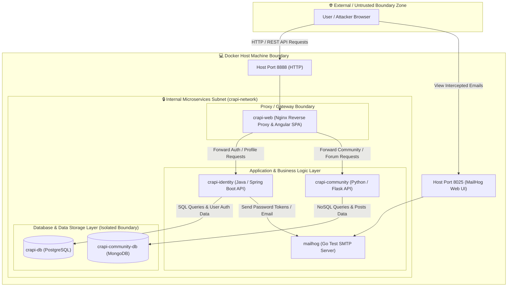

# OWASP crAPI - System Version & Architecture Inventory

## 1. Project Overview & Version Reference
- **Target Application:** OWASP crAPI (Completely Ridiculous API)
- **Repository Reference:** Official OWASP crAPI GitHub Baseline
- **Deployment Mode:** Multi-container Local Deployment via Docker Compose
- **Environment:** Isolated Local Lab Environment (Dual-boot Kali / Windows OS)

---

## 2. Microservices Architecture & Container Inventory

The OWASP crAPI architecture comprises multiple decoupled microservices communicating across distinct internal and external trust boundaries.

| Service Name | Description / Role | Tech Stack / Base Image | Internal Container Port | Exposed Host Port | Primary Dependencies |
| :--- | :--- | :--- | :--- | :--- | :--- |
| **`crapi-identity`** | User authentication, identity management, JWT generation & profile management. | Java / Spring Boot | `8080` | None (Internal) | PostgreSQL (`crapi-db`) |
| **`crapi-community`** | Community forums, user posts, mechanics dashboard & comments. | Python / Flask / Python REST API | `8080` | None (Internal) | MongoDB (`crapi-community-db`) |
| **`crapi-web`** | User Interface (Frontend SPA) and reverse proxy routing. | Angular / Nginx | `80`, `443` | `8888` (HTTP), `8443` (HTTPS) | `crapi-identity`, `crapi-community` |
| **`crapi-db`** | Primary relational database for user profiles, credentials & mechanics data. | PostgreSQL | `5432` | None (Internal) | Persistent Volume Mount |
| **`crapi-community-db`** | NoSQL database for community posts, forum threads & unstructured data. | MongoDB | `27017` | None (Internal) | Persistent Volume Mount |
| **`mailhog`** | SMTP email testing server for capturing registration & password reset tokens. | Go (MailHog) | `1025`, `8025` | `8025` (Web UI) | None |

---

## 3. Network Boundaries & Port Mappings Summary

- **Host Exposed Web Interface:** `http://localhost:8888` (or `https://localhost:8443`)
- **MailHog Test Email Console:** `http://localhost:8025`
- **Internal Microservice Subnet:** Isolated Docker Bridge Network (`crapi-network`)
- **Direct Database Access:** Internal network only (PostgreSQL and MongoDB are strictly unexposed to host interface for security isolation).

---

## 4. Key Dependencies & Software Components

1. **Frontend Layer:** Node.js, Angular, Nginx (Reverse Proxy).
2. **Identity Backend:** Java 11+, Spring Boot, Spring Security, JWT (JSON Web Tokens).
3. **Community Backend:** Python 3.x, Flask framework, PyMongo client.
4. **Data Persistence Layer:** PostgreSQL 12+, MongoDB 4.x+.
5. **Messaging & Utility:** MailHog SMTP server.

---

## 5. Verification Command Checklist

To verify runtime state and update exact image digests in your local environment, run:

```bash
# Check running container statuses and port mappings
docker compose ps

# Inspect internal network setup
docker network inspect crapi_default
```

## 6. System Architecture

## 7. System Trust Boundaries Breakdown

1. **External / Untrusted Boundary (Boundary 1):**
   * **Technical Scope:** User Web Browser $\rightarrow$ Docker Host Network.[cite: 17]
   * **Security Context:** Siyaluma pitathin paminenena Traffic paminenne meema seemaveni. Injection payloads, malicious tokens, saha automated scanners pamineeya hakkhe methanini.[cite: 17, 42]

2. **Docker Container Perimeter Boundary (Boundary 2):**
   * **Technical Scope:** Host Ports `8888` / `8025` $\rightarrow$ `crapi-web` saha `mailhog` Containers.[cite: 17]
   * **Security Context:** Host OS eka saha Containers ven karana seemavayi. Nginx reverse proxy eka magin abhyanthara Microservices vetha Request sarjuvam yaama paalanaya karayi.[cite: 17]

3. **Internal Microservices Subnet Boundary (Boundary 3):**
   * **Technical Scope:** `crapi-web` $\rightarrow$ `crapi-identity` & `crapi-community`.[cite: 13, 17]
   * **Security Context:** Abhyanthara `crapi-network` Docker bridge jaalayayi. Microservices ekinaka athara REST APIs haraha dattha huvamaaru kara gani.[cite: 17]

4. **Data Isolation Storage Boundary (Boundary 4):**
   * **Technical Scope:** Backend Services $\rightarrow$ PostgreSQL (`crapi-db`) & MongoDB (`crapi-community-db`).[cite: 13, 17]
   * **Security Context:** Databases sarjuvam pitathata Exposure kara nomathi athara, abhyanthara Backend Services valata pamanak Access pahasukam atha.[cite: 13, 17]

    